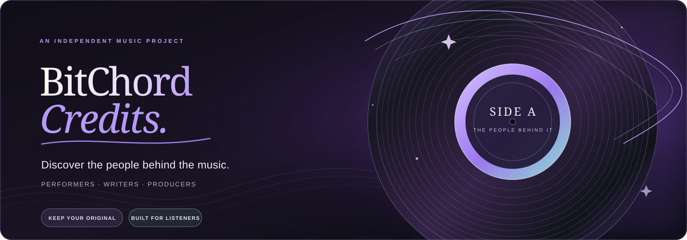

<div align="center">



<br>

<sub>AN INDEPENDENT MUSIC PROJECT · ANDROID · SONG CREDITS · GPL-3.0</sub>

<br><br>

<a href="https://heobeep.github.io/BitChord/">OPEN THE INTERACTIVE DOWNLOAD GUIDE ↗</a>
&nbsp; · &nbsp;
<a href="https://github.com/heobeep/BitChord/releases">BROWSE RELEASES ↗</a>
&nbsp; · &nbsp;
<a href="https://github.com/kushagrasinghx/BitChord">UPSTREAM BITCHORD ↗</a>

<br><br>

[](https://github.com/heobeep/BitChord/actions/workflows/song-credits-apk.yml)
[](https://github.com/heobeep/BitChord/releases/latest)
[](LICENSE)

</div>

> BitChord Credits is an independent community fork of [BitChord](https://github.com/kushagrasinghx/BitChord), built around one small idea: the song is more than the name on the screen. Discover the performers, writers, musicians and producers behind the recording.

---

## 01 / Choose your pressing

The easiest way to install is through the [interactive download guide](https://heobeep.github.io/BitChord/). It reads the latest published release, checks which files are actually attached, and helps pick the right build for your device.

<div align="center">

| KEEP ORIGINAL | REPLACE ORIGINAL |
|:--|:--|
| **Recommended** | **Only when CI confirms MATCH** |
| Installs as a separate app. Your official BitChord and its data stay in place. | Uses the official package ID. Android must verify the signing certificate and version before an in-place update is safe. |

</div>

> [!IMPORTANT]
> **Not sure what ARM means? Choose Keep Original → Universal.** You do not need to know your phone's processor. Universal includes all supported Android architectures and leaves the official app untouched.
>
> Replace downloads are withheld whenever compatibility is a mismatch or cannot be confirmed. Never force an install past an Android signature warning or uninstall the original just to try this fork; that may erase private app data.

### Device notes

- **Universal** — easiest choice if you're unsure.
- **arm64-v8a** — most modern Android phones and tablets.
- **armeabi-v7a** — older 32-bit ARM devices.
- **x86_64** — Android emulators and x86_64 Chromebooks.

These are phone/tablet builds. Android TV has its own separate app and release path.

## 02 / Read the liner notes

### Credits, where you listen

Open a track's **Song Info** to explore the contributor details available for that recording: performers, musicians, songwriters, composers, producers, arrangers, recording and mixing engineers, publishers, labels and more.

### Metadata, not guesswork

Credits can be enriched through optional **Credits.fm** integration and supporting music metadata sources. A connected ListenBrainz integration may also be used for supporting lookup; its token is not forwarded to Credits.fm.

Catalogues are incomplete, so some recordings may have limited or no contributor information. Missing results do not mean a track has no credited people.

## 03 / The listening room

BitChord Credits keeps the wider BitChord player foundation familiar:

| FIND | KEEP | LISTEN |
|:--|:--|:--|
| YouTube Music search, browsing and playback | Playlists, library, local music and offline downloads | Lyrics, artwork, dynamic theming and playback controls |
| **CONNECT** | **CONTROL** | **DISCOVER** |
| Last.fm and ListenBrainz scrobbling | Queue tools, sleep timer and audio settings | Song Info and available recording credits |

The exact feature set can evolve with upstream BitChord and this fork.

## 04 / Privacy, plainly

- Song-credit lookups require network access and may send track-identifying metadata, such as title and artist, to the relevant provider.
- Your ListenBrainz token is not forwarded to Credits.fm.
- API keys and integration settings use the app's existing account/settings infrastructure.
- BitChord Credits does not host a catalogue of music files.

Use only credentials you're entitled to use, and review the policies of the external services you connect.

## 05 / For the curious

This repository holds more than the Android app. The main areas are:

```text
app/                  Android application
shared/               Shared application logic
sharedUi/             Shared interface components
tv/                   Android TV app
wearos/               Wear OS app
web/                  Web application
backend/              Backend services
scripts/build-song-credits/
                      Credits patch and build helpers
site/                 Interactive project website
.github/workflows/    Build, test and release automation
```

The release pipeline builds and verifies separate install modes, checks package IDs and signing fingerprints, and withholds Replace assets unless the compatibility report returns an exact MATCH. CI success is not a claim of physical-device testing.

Before contributing, read [CONTRIBUTING.md](CONTRIBUTING.md), [MAINTAINERS.md](MAINTAINERS.md) and [AGENTS.md](AGENTS.md). Issue tracking is currently disabled on this fork; propose Credits-specific fixes through a pull request. Never post API keys, passwords, signing material or private account data.

## 06 / Credits & license

Built on the work of the original [BitChord project](https://github.com/kushagrasinghx/BitChord) and its contributors. Thanks to the upstream developers and the open music-metadata services that make richer credits possible.

Distributed under the **GNU General Public License v3.0 (GPL-3.0)**. See [LICENSE](LICENSE) for the full terms.

<div align="center">

<sub>INDEPENDENT COMMUNITY PROJECT · NOT AFFILIATED WITH YOUTUBE, GOOGLE, CREDITS.FM OR THE UPSTREAM BITCHORD MAINTAINERS.</sub>

</div>
